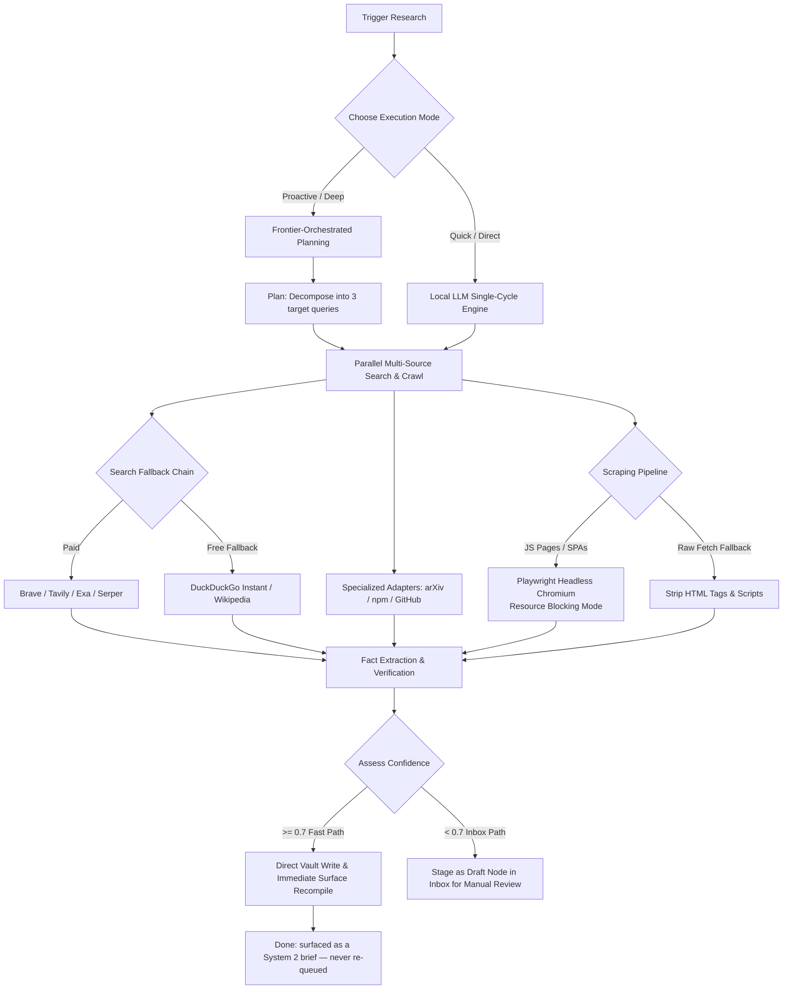

## 🎯 SYSTEM OVERVIEW & WORKFLOWS

Under the hood, the engine performs deep context collection, crawls live web pages, cross-verifies facts across multiple independent APIs, and compiles structured Markdown memory nodes with valid SSSS v2 metadata.

---

