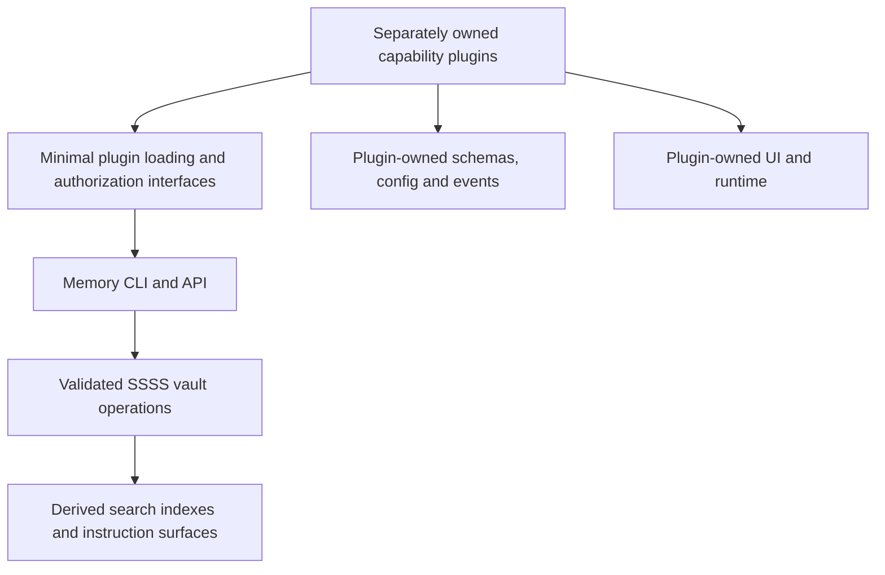

# TR_CORE_PLUGIN_SPLIT — Architecture

2026-10-21 continuation: daemon-owned elapsed-time maintenance dispatches bounded CLI children; package-manager work never blocks the daemon event loop. Auth owns secure LaunchAgent carrier resolution. Mesh owns access discovery, limits and verified execution. Cross-project reporting reads the registry, ordinary five-file project docs and validated task envelopes through their owners; it never treats filesystem timestamps or checked boxes as production proof.

> **Project Prefix**: `TR_CORE_PLUGIN_SPLIT`
> **Kanban State**: In Progress
> **Date**: 2026-10-07
> **Based on audit**: TR_CORE_PLUGIN_SPLIT_AUDIT.md (Complete, 9b2e21f)

## Target



The diagram is the target. Current source still directly mounts feature routers and embeds agent/research task behavior. Extraction is incomplete.

## Current source and required boundary

| Area | Current owning source | Target owner / required proof |
| --- | --- | --- |
| Memory and instructions | `src/core/kernel-*`, vault/search/recall/surface/context; memory/instructions/rules routes | Core; offline memory workflow and complete required-rule coverage |
| Plugin discovery and artifact loading | `src/core/plugin-loader.mjs`, plugin-store/runner/context, `src/cli/plugin.mjs` | Minimal generic host contract; digest, scope, lifecycle and failure isolation |
| Feature router/tool mounts | `src/server/rest.mjs`, `src/server/tools.mjs` | Manifest-driven scoped contracts consumed by plugin owners |
| Research, agents, scheduling and host administration | `src/core/daemon-loop.mjs`, task-executors, research, runtime/meta-harness, mesh and rotation modules | Capability plugins; generic memory maintenance retained only with a justified interface |
| Skill registry/config/optimizer and IDE tooling | skills-registry, skill-config, skill-optimizer, skill CLI/connect/startup modules | Tooling plugins/adapters; preserve repo-owned layers and instruction access |
| Capability app composition | `src/core/app-deploy/`, `src/cli/app/` | Composer plugin; canonical scaffolding, operation-backed state, independent runtime |
| Plugin product panels | `frontend/src/components/plugins/previews/`, PluginsPage and capability pages | Installed plugin-owned interfaces; host supplies generic slots only |
| Browser capture and integration | `extension/`, capture/import/integration routes | Extension/capture capability owner; explicit permissions and actual installed reload proof |
| Cloud service and rollout | current launch/service configuration and `scripts/auto-pull.sh` | Operations owner; deployment cannot stop the sole serving process |

## State and compatibility

A plugin owns its extension schemas and writes through authorized SSSS operations. Rebuildable projections may cache state but cannot become an independent source. Memory and app records survive uninstall. Secret access uses audited references/grants; public artifacts contain no private values or machine instances.

Reuse existing capability repositories and source rather than reconstructing each feature in the core. Compatibility command adapters delegate to the owner, expose failures and have a recorded removal condition. No permanent duplicate implementation. A missing plugin reports unconfigured/unavailable instead of running a hidden built-in substitute.

## Minimum migration path

Select an existing working capability with low coupling, use its existing repository/artifact, and prove the smallest memory-host interface needed to install and invoke it. Existing CLI/task/loading interfaces are the starting point. Route/tool/event/UI extension families are not a prerequisite bundle; introduce only an interface required by a selected real consumer.

Audit every remaining feature import as reused/extracted, removed as unused, or a necessary generic memory interface. Preserve existing data even when unused code is removed. The app composer and new capability catalogs remain with their external owners and have no new core implementation scope.

## Shared contracts

The host loads installed `ui.elements` custom elements through the existing confined authenticated module route. It supplies a scoped bridge for declared CLI operations, selected-brain API access and credential metadata/storage. Purpose-specific state, controls, provider SDKs and configuration definitions reside in owner repositories. No hardcoded plugin-ID UI registry remains in the host. Owner modules are self-contained browser bundles. Credential values never enter manifests, vault records, module URLs, arguments or success output.

Add route/tool/event/config/UI contracts only when an extracted consumer requires them. Define namespace, permissions, timeout, unload, restart, error propagation and artifact identity together. The current schema's UI/app CLI fields and generators are useful source foundations, but they do not prove generic runtime mounts or independent app execution.

Installation needs artifact identity and a verified selected-plugin path. Memory initialization has no feature-bundle dependency. New public exchange/discovery/reviews are outside this reduced project; their plugin owner can support those behaviors with its own evidence. Remove unsupported core trust surfaces during extraction. Memory-host acceptance does not require every provider or every distribution channel.

## Project architecture

This five-file project owns order and acceptance. `evidence/consolidation/source-items.json` maps all 549 historical checklist claims, and `SOURCE_PROJECT_REGISTER.md` explains each predecessor's disposition. Archived projects retain their original documents and logs with successor links. External owner projects are dependencies, not competing Total Recall plans. HANDOFF points here first.

## Compatible release boundary — 3.39.0

The release retains existing `total-recall`, `npm start`, package root export and dashboard/plugin scaffold. `total-recall-memory`, `start:memory` and the `/memory` export provide the isolated memory runtime. This preserves recent extraction work without silently removing existing consumer interfaces. The final default memory-only artifact remains a breaking migration with its original implementation acceptance. Host update status uses semantic precedence independently of older registered consumers.

## Proposed generated card face boundary

Reuse the plugin-owned custom element and host operation contracts. The generation capability belongs to an explicit plugin owner, while Total Recall hosts loading and authorized operations. Supply a redacted capability/state description, design tokens and the available card dimensions. Validate generated code and its declared controls before mounting, retain the last working face after failures, and update live values through a stable host contract. Code generation and live state refresh are distinct operations so forms retain their state. This is a proposed addition, not implemented or verified behavior.

## Security boundary refresh — 2026-10-08

Plugin UI owner code now loads in an opaque-origin scripts-only iframe with CSP prohibiting direct network requests and embedding. The parent accepts messages only from the exact frame and a fresh channel, bounds command arguments/concurrency, and dispatches only manifest-declared subcommands under existing server authorization. Browser isolation does not sandbox installed native handlers. The model generator must use masked metadata and this UI boundary; it cannot receive raw secrets or install generated native handlers automatically.

## Verified pre-launch security candidate — 2026-10-08 UTC

The current candidate security checks pass for exact source `72abfdd410ebdc9fae6bda227a8fd05745e415b988b24331979cc43c10d56207`: nine gates, 383 test files and 2,405 tests, native source/installed health, clean consumer dependency audit and 43 installed lifecycle operations. Both lockfiles have zero reported advisories. Publishing dry run passes; all 579 package files match between test/publishing hosts, with zero credential-pattern/private-credential-path matches. Initialization preserves existing and concurrent credentials. Test-host configuration was restored byte-exact from the pre-incident snapshot, canonical memory preserved, owned additions quarantined, local indexes rebuilt with zero drift and snapshot unmounted. SSH cannot unlock the restored store, so live decryption remains unverified. Detailed evidence: [security audit](evidence/release-3.39.0/security-audit.md). Model-generated card faces remain unimplemented and unaudited; the project stays In Progress. No publication or live runtime upgrade.

## Mesh owner boundary — 2026-10-10

Move existing mesh implementations into the linked mesh plugin; preserve one implementation. Generic declared runtime modules and HTTP routers are loaded through the plugin host. Existing internal imports may use compatibility bindings with no implementation; public CLI must use installed-plugin dispatch exclusively. Plugin card reads the same owner status contract as CLI/API. SSSS remains the canonical node/event mutation path.

### Required auth boundary

Auth owns encrypted credential carriers, cryptography, catalog, provider verification, rotation, deployment projections, sync, CLI and REST secret operations. Core uses the generic plugin runtime loader to request declared auth exports; it contains no duplicate credential implementation. The shipped auth artifact is reproducibly copied from its owning repository into scaffold, seeded before first use. Missing or invalid auth and failed decryption are errors. No legacy CLI dispatch or environment secret fallback.


### Security machines and network

Security owns platform collectors, findings, remediation and purpose-specific UI. Mesh owns inventory and remote transport; auth owns credential storage. Collectors execute fixed argv with bounded time/output, never arbitrary user shell. Fleet invokes the installed security machine collector remotely, validates report schema/freshness and records unreachable/unsupported nodes. No agent installation, topology constants or implicit local substitution.


### Windows and mobile platform coverage

Security plugin owns Windows/Android native adapters, device profiles, report validation and UI. Mesh remains transport/inventory owner; auth remains credential owner. Fixed bounded command argv; no arbitrary PowerShell, shell interpolation, recovery-key queries, ADB network connect, privilege escalation or device mutation. Guided results are stateless reports with validated statuses/timestamps, no arbitrary notes or secret values. Mobile guided reviews are explicit modes, never silent substitutes for failed native checks.


2026-10-10T07:39:00Z — Codex: Security owner src/windows.mjs provides fixed PowerShell read-only commands; src/android.mjs checks exact authorized serial and four fixed getprop properties; src/devices.mjs owns platform profiles and bounded expiring user attestations. No mobile/ChromeOS collector fallback. UI supplies per-check status/time only, resets on identity change, and invokes the declared device command. Core has no new device-specific implementation.


2026-10-10T17:48:38.043211+00:00 — Codex: Move dashboard authentication implementation behind required auth runtime factory with injected generic host configuration/key interfaces. Auth owns JWT service and encrypted dashboard password records. Core adapters expose operations only. Route OAuth and collaboration signing through auth operations, never raw keys. Default store identity must be explicit and consistent across readers and writers.

### Auth session boundary (2026-10-10)

Auth supplies server-auth, auth-router, webauthn-router, session-credentials, access-keys, webauthn-store, credential-migration and credential-preservation runtime modules. Core injects host configuration/logging/scope contracts into owner factories and exposes compatibility adapters. Signing and password material stays in the selected encrypted auth store. PAT records contain hashes only; passkeys contain public authenticator material. Legacy credential import is an explicit owner action with verified commit before removal. Generic scaffold dependency wiring binds declared compatible installed packages; missing dependencies fail bootstrap.


2026-10-10T18:26:25.985393+00:00 — Codex: Auth host adapters import only selected absolute TR_PACKAGE_ROOT through its validated host module helper. Runtime projection exposes only an allowlist of provider values, excluding password hashes, signing keys and master material. API command inventory derives from the actual mounted Express stack, including plugin routers. Pure plugin cron parsing has no mesh dependency; peer source operations load their required owner on demand.


2026-10-10T18:35:44.132567+00:00 — Codex: Full core suite now passes 336 files / 2,025 tests, actual exit 0 (core-full-auth-verified.log). Auth owner passes 11 Node + 154 Vitest tests, actual exit 0; strengthened global-store isolation fixture still needs final rerun. Fast gates prior to final auth CLI source update passed all eight. Auth secret get no longer selects a second store, honors TR_SECRETS_BRAIN, and supports structured found/value JSON for internal consumers. Continued all-plugin bypass remediation across service owners, with auth-only client transport tests. Initial owner runs expose stale environment/fake-result assertions and missing snapshot dependency/runtime files; repairing both. Maps generated results and Maps/Stripe fabricated probes confirmed and removed in edited source. No all-plugin clean result, release or deployment claimed.


2026-10-10T18:38:09.122266+00:00 — Codex: Security scanner strengthened to report dynamic credential environment access and uninspected linked source, without matched contents. Added negative fixture. Service owner tests now use explicit auth fixtures rather than ambient credentials; Phone/Text and Signing tests reject removed fallbacks. Maps/Stripe denial probes covered. Owner snapshot initially omitted Phone runtime package and Skill Manager root specs, and lacked SSSS package; repairing selected source/dependency snapshot without copying any brain/vault. All changes remain unshipped; final owner/security reruns pending.


2026-10-10T18:59:01.594783+00:00 — Codex continuation verification: full current core 336 files / 2,025 tests passed, actual exit 0 (core-auth-final2). Auth 11 Node + 156 Vitest tests passed, exit 0; eight fast gates passed, exit 0. All 15 earlier service-owner suites passed, exit 0; later Alerts auth cutover passes 10 tests, exit 0. Mesh selected-host runtime suite passes 25 files / 249 tests, exit 0; manifest/host rejection checks pass 3 tests, exit 0. Security expanded-language scanner passes 28 tests, exit 0. Deploy execution/health/UI contract passes 10 tests, actual exit 0. No live provider, credential, machine setting, deployment or release changed.

All 29 installed manifests declare auth, but the source audit returns exit 1, not all-plugin certification. Expanded Python/shell coverage confirms unresolved CRM local_config.py, session/hash, google_auth.py and cli_client/crm_client.py credential storage. User/operator secret transport has since moved to auth; other paths remain active migration work. These are active required repairs. Regex review also flags authorized auth unlock/store selection and nonsecret checker interpolation; findings require source classification. Source tests cannot certify live hardware, providers, operational deployment adapters or comprehensive UI acceptance.


2026-10-10T23:58:50.683704+00:00 — Codex: Local CRM settings retain nonsecret configuration. Credential fields use runtime/auth_credentials.py CONFIG_<FIELD> scoped refs. Errors propagate; migration preflights conflicts before verified writes and cleanup. Environment projection derives from auth, never ambient credential sources. OAuth/session/client ownership remains in progress.


2026-10-11T00:04:35.943935+00:00 — Codex: CRM CONFIG_<FIELD> credential references resolve only through auth. Local config persists nonsecret fields and reference names; explicit migration performs conflict preflight, readback and source-change refusal before atomic cleanup. OAuth client fallback removed. Explicit init uses auth-owned secret generation; ordinary startup fails on missing required credentials.


2026-10-11T00:13:26.919269+00:00 — Codex closed generated API transport ambient CRM/DABBER key bypass and local-daemon startup side effect. Expanded focused suite passes 31 tests, actual exit 0. Initial new test run had two harness errors because extracted function annotations omitted the original deferred-annotation flag; harness corrected and rerun passes. Full CRM runtime/OAuth tokens/session hashes/standalone client/provider paths remain required work. Source identity now includes 19 files; refresh audit after this repair.

## Plugin tiers, bricks, store and monetization — 2026-10-11
**Tiers and class.** `plugin.json` gains `distribution: { tier, license }`. The loader validates it; `plugin available` lists only plugins the package actually carries, and local installs show their real source. Core tier = `auth`, `mesh`, `openwiki`, `okf`, `decision`, `code-quality`, `composable-cli`, `git-sentinel`, `skill-manager`, `security`, `system-monitor`, `user-automations`, `operator-alerts`. These must move into `PACKAGE_ROOT/plugins` or be fetched by hash-pinned install at `init` so they actually ship.

**Bricks (open).** `plugin vendor` copies source into `bricks/<id>` and `tr-bricks.json`. `total-recall new` is a thin orchestrator: create folder, `git init`, project brain, SSSS project files, instructions, scripts, then `plugin vendor` for each requested brick, then print the dependencies to install. Order and conflicts are resolved by the declared `requires` of each manifest.

**Closed, monetizable plugins (service-backed).**
```
user project / agent ──► thin client (installed plugin, open or closed shell)
                              │  license key from `auth`, signed requests
                              ▼
                     operator-hosted service (closed)
                       - holds provider accounts (telephony, registrar, mail, search)
                       - meters usage per customer, enforces plan/credits
                       - bills via payment provider, pays out to `recipient`
```
Local code is never the enforcement point. The client reports a clear error when the license is missing, expired or out of credit. Monetized usage is visible in the plugin card.

**Store.** A separate service: publisher accounts with signing keys; versions are immutable, signed and hash-pinned; install verifies signature and hash; security review gate before listing; payouts to the manifest `recipient`; `plugin install <id>` resolves from the store. The store lists and serves artifacts; it never executes plugin code. It reuses the existing hash-pinned share link and mesh paths.

**Third-party authoring.** `plugin create` plus a published contract and a conformance test kit (`plugin test`) that checks manifest validity, credential handling through `auth`, no ambient environment credentials, and card UI rules.

**API wrapper generator.** `plugin from-openapi` reads an OpenAPI document and emits commands, schemas, credential setup via `auth`, offline tests with recorded fixtures, and a README. Output is open.

**Boundaries kept.** Core still has no secret implementation and no feature code; the store, `new` and the generator ship as plugins or CLI modules behind the existing loader.

## Neutral names and personal variants — decided 2026-10-11
Official and core plugins carry neutral, descriptive display names (no invented brands). Ids, commands and state paths do not change. Renamed on 2026-10-11 (uncommitted in each plugin repo): auth → Auth & Secrets; code-quality → Code Quality Gates; composable-cli → Composable CLI; creative-search → Metasearch; crm → CRM (default product name `CRM`, default public URL `http://127.0.0.1:3015`); decision → Decisions; deploy → Zero-Downtime Deploy; design → Design Tokens; dsh → Harness Bridge; git-sentinel → Git Hygiene; image-generator → Image Studio; maps → Maps; mesh → Mesh Control; okf → Knowledge Schema (OKF); operator-alerts → Operator Alerts; phone → Telephony; security → Security Assessments; skill-manager → Skill Manager; stripe → Payments; system-monitor → System Monitor; text → SMS & MMS; tr-transcribe → Transcription; user-automations → Scheduled Tasks. `openwiki` keeps its feature name.

**Personal variants stay exactly as they are** and are tier `personal`: `domains` (Holy MX, built on the owner's mail server), `translator` (the owner's multi-locale pipeline), `tickets` (the owner's checkout), `signing` (the owner's e-signing product), `sticker-generator`, `phone-companion`. Their ids are taken, so the generic official versions need new ids (decision at PE-B; recommendation: official `esign`, `domains-mail`, `i18n`, `ticketing`, and keep the personal ones unrenamed). The official generic versions are new work that generalizes the code, not a rename.

## Functional card (manifest-driven) — 2026-10-11
**Contract v1 additions to `plugin.json`** (all optional; a plugin without them still gets a card listing its commands and secrets):
- `cli.subcommands[].args`: `[{ name, flag, label, type: string|number|boolean|choice, required, options, default, description }]`
- `cli.subcommands[].effect`: `read` (default), `write`, `destructive`, or `send` (reaches a third party); `output`: `json` or `text`; `timeout_ms` (exists).
- `status`: `{ command: "status", refresh_seconds }`. The command prints JSON `{ ok, summary, items: [{ label, value, state: ok|warn|error|unknown }] }`.
- `configuration.fields` and `secrets[]` unchanged, but every plugin declares the ones it really uses.
- `card_face.metrics` is removed; `card_face` keeps only an optional `panel` pointer for the Live view.

**Renderer.** A single host component renders sections: Overview (status items, last run, tier and license class), Actions (grouped by effect, argument form, confirmation, output viewer with copy), Settings (configuration form), Credentials (write-only, present/missing), Activity (recent runs this session with exit state and duration), About (version, source, docs). Plugin panels mount under "Live view" in the existing sandboxed frame.

**Bridge.** `host.run(subcommand, args, { stdin })`. `stdin` is accepted only for subcommands whose manifest marks an argument `secret: true`, or for the standard `secrets set <KEY>` command; the host passes it over the child's stdin and never logs it. The frame stops hard-coding plugin tags and events; plugin panels dispatch generic `run` events only.

**Standard subcommands** each plugin implements where relevant: `status --json`, `config get|set --json`, `secrets status --json`, `secrets set <KEY> --stdin`. A conformance test in `plugin test` verifies them, so third-party plugins get the same card.

**Design system.** One token set (`DESIGN.md` per plugin falls back to host tokens), neutral graphite surfaces with one accent per plugin, 8 px spacing scale, a type scale, state colors that meet contrast (ok, warn, error, unknown), focus rings, reduced-motion respected, no animation other than state transitions of 150 ms.

## Layout contract and per-plugin design (supersedes the single-renderer note above) — 2026-10-11
The engine is shared; the design is not. A plugin declares `card_layout` in `plugin.json`:
```json
"card_layout": {
  "template": "ledger",
  "regions": [
    { "widget": "status",  "variant": "strip" },
    { "widget": "table",   "source": { "command": "view", "path": "payments" }, "columns": [{ "key": "id", "label": "Payment" }, { "key": "amount", "label": "Amount", "format": "money" }] },
    { "widget": "actions", "variant": "palette", "commands": ["checkout", "refund"] },
    { "widget": "credentials" }
  ]
},
"branding": { "color": "#635bff", "accent": "#0a2540", "font": "ibm-plex", "density": "compact", "radius": "sm", "header": "ledger-rule" }
```
**Templates** (page composition): `console` (primary form beside output), `ledger` (table first with a side action rail), `monitor` (gauge/status tiles above a live log), `inbox` (list and detail), `dashboard` (status tiles, then actions), `workbench` (tabs for several tools), `vault` (record list with per-row actions). A template fixes the arrangement and responsive behavior; the plugin chooses it by function.
**Widgets** (all bind to real command output or host data, never constants): `status`, `actions`, `table`, `detail`, `log`, `form` (a command's arguments as the primary control), `keypad` (dial/numeric entry), `gauge`, `list`, `settings`, `credentials`, `activity`. A widget whose source command is missing or fails shows that state honestly.
**Brand tokens** come from `branding` and the plugin's `DESIGN.md`: color, accent, font from a fixed vetted set, density, radius, header treatment, state colors derived with contrast checks. Hard-coded colors in plugin code are rejected by the conformance test.
**Custom Live view.** A plugin that needs a bespoke surface (for example a DNS zone editor) mounts its sandboxed panel in a `live` region; it still gets the standard Actions, Settings and Credentials regions from the engine.
**Design brief per plugin** (initial assignment; each gets a written `DESIGN.md` with rationale):
auth `vault` (credential list, passkeys, rotation age); stripe `ledger`; domains `workbench` (zone table, mailbox list, DNS editor live view); phone `console` + `keypad` (dial, lines, sessions); text `inbox` (threads and composer); signing `ledger` of agreements with status stages; maps `console` (query form, result list, route detail); crm `dashboard`; security `monitor` (findings by severity); system-monitor `monitor` (gauges); mesh `workbench` (nodes, peers, access); deploy `monitor` (release stages, health, rollback); code-quality `ledger` of gate results; decision `inbox` of pending decisions; design `console` (token inspector); image-generator `console` with asset grid; creative-search `console` with ranked results; openwiki `workbench`; okf `console`; skill-manager `ledger`; operator-alerts `inbox`; user-automations `ledger` of scheduled tasks; git-sentinel `ledger` of repos; dsh `monitor`; composable-cli `workbench`; translator `ledger` of locale coverage; tickets `ledger` of passes; tr-transcribe `console`; sticker-generator `console` with asset grid; phone-companion `monitor` of devices.

## Brand, logos, drawer and tracking — 2026-10-11
**Names.** `branding.provider = { "name": "Stripe", "url": "https://stripe.com" }` marks a wrapper; its display name is the provider name. A plugin without `provider` is first-party and uses a descriptive name or, when monetized, its own brand. The two can coexist: `telnyx-voice` (open, bring your own key) and a separately branded managed service built on it.
**Logos.** `branding.logo` is a safe relative path to an `.svg` or `.png` inside the plugin (SVG is sanitized: no scripts, external references or event handlers; maximum size enforced). The card header and the plugin list render it. Provider logos are sourced from the provider's official brand kit or the Simple Icons set where the brand is present; each logo's source and license note is kept in `ui/LOGO.md`. First-party and monetized plugins ship an original logo mark designed for them. `branding.icon` (emoji) is deprecated and produces a warning.
**Drawer.** The card is a compact face (logo, status, the two or three primary actions). A right-hand slide-out drawer opens for Settings (configuration form), Credentials (write-only, present or missing), Usage (charts for calls, errors, latency, units and cost over time, selectable by project) and Projects (installations). The drawer is a host component driven by the manifest and the ledgers; plugins do not implement it.
**Installation ledger.** `plugin vendor` and `new` write a record through the existing plugin event emitter into the user's brain: `{ plugin, version, sha256, project_path, project_id, added_at }`, and keep `tr-bricks.json` in the project. A project that moves or is deleted shows as missing. Nothing leaves the machine.
**Usage ledger.** Each brick ships a tiny `usage` helper (`bricks/<id>/usage.mjs`) that appends `{ at, command, exit, ms, units, cost_cents }` to `<project>/.tr/usage/<plugin>.jsonl` and nothing else. Directly installed plugins record the same through the plugin runner. The dashboard reads the ledgers of every project in the global project registry. Closed services meter server-side per project key; the drawer shows the service's figures for those. Opt-in reporting (for example a maintainer wanting aggregate install counts) is a separate, explicit setting with a documented payload.

## Operated telephony product — recommendation, 2026-10-11
The owner operates the PBX (Asterisk) and the carrier relationship (Telnyx) together, and charges for lines. `tr-plugin-phone` already runs an Asterisk ARI listener and shares one Telnyx client package (`packages/telnyx`) with `tr-plugin-text`; both use the same credential and the same phone numbers.
**Recommendation: one branded product, one plugin, command groups.** Voice (calls, sessions, WebRTC, voicemail, routes), Messaging (threads, send, ingest, 10DLC), Numbers and Lines (search, purchase, assign, E911, extensions) and Compliance in a single plugin under one brand. Reasons: a phone number is one resource that carries both voice and messages; the billable unit is the line; one drawer shows lines, usage and cost together; one license key and one per-project key meter everything; a seller buys one thing. The open bring-your-own-account wrappers (Telnyx Voice, Telnyx Messaging) stay as separate open bricks for developers who only want one API with their own key. The branded product reuses their code; it does not replace them.
**Metering.** Billable units are lines per month and per-use events (minutes, messages, number purchases, E911). Per-project keys attribute usage; the drawer's Usage tab reads the service meter.
**Open question for the owner:** the product name and logo mark. The same applies to the operated metasearch and mail hosting products.

## Operated products (one-stop shops) — decided 2026-10-11
The owner runs the underlying infrastructure and sells it as branded products. Each is one closed, service-backed plugin with its own name, logo and drawer; the open provider wrappers stay separate for developers who bring their own accounts.
| Product (brand pending) | Operated infrastructure | Commands | Billable units |
| --- | --- | --- | --- |
| Telephony | Asterisk PBX, Telnyx carrier | calls, sessions, messaging, numbers and lines, E911, 10DLC, compliance | lines per month; minutes, messages, number purchases |
| Mail and domains | Mailcow servers, SMTP2GO relay, Vercel domains and DNS | register and transfer domains, DNS, mailboxes, aliases, SPF/DKIM/DMARC, transactional send, bounce and reputation | domains, mailboxes, sent messages |
| Metasearch | the owner's SearXNG instance | search, categories, deep research, memory integration | queries |
**Email and domains are one plugin.** A domain, its DNS records and its mailboxes are one lifecycle: buying a domain provisions DNS and mail records; adding a mailbox needs the domain's SPF, DKIM and DMARC aligned; sending uses the relay with those same records. One plugin removes the hand-off between two products and gives a single meter. The existing personal `domains` plugin (Holy MX: Vercel DNS, Mailcow, SMTP2GO) is the working base for the product; the separately planned `email` plugin (PE-11) folds into it.
**Shared service pattern.** Each product has: a thin client plugin; a hosted service holding the provider accounts; a per-project key for attribution; a meter with included allowances and overage; a price list in the manifest `monetization` block; a drawer showing lines or domains, usage and cost per project; and honest states when a provider call fails.
**Brand.** Each product needs a name and an original logo mark chosen by the owner. Provider names appear only in the about text as credits.


## Workspace host and contact-store interface — 2026-10-11

- **Manifest:** optional `workspace: {component, tabs[], permissions[]}`. `permissions` may include `microphone`; the host shows its own prompt and the sandbox frame never receives it. A workspace is rendered by the drawer; the card body stays configuration and status.
- **Bridge:** workspace calls run only declared CLI commands through `host.run`; secrets go to declared secret args on stdin. Long-lived events (incoming call, new message) arrive as `host.subscribe(topic)` over the plugin event emitter, so the drawer and an agent see the same events.
- **Hello Phone layout:** `console` template for the card (status, numbers, agents, usage) plus the drawer workspace tabs Dialer, Calls, Messages, Contacts, Agents, Settings.
- **State:** `.tr/phone/<e164>/{contacts,threads,calls,notes,recordings}` as Markdown/JSON files in the project (portable, owned by the project); a derived index is disposable.
- **Contact-store interface:** `contacts.lookup|search|get|upsert`, `activities.log`, capability flags `read`/`write`, field mapping. Providers register by capability name, so any plugin can supply or consume it. Resolution order for a number: configured primary store, then local.
- **Our CRM:** `tr-plugin-crm` implements the interface with read and write, plus transcripts, notes, call outcomes and thread history attached to the contact. Other CRMs ship as read-only adapters first; write adapters are added per system and opt-in per number.


## Reuse the festech dialer for Hello Phone — 2026-10-11 (owner direction)

Source: `festech-modular/apps/web` (read-only for us; that repo is mid-modularization and dirty). Files: `components/comms/PhoneDialer.tsx` (2,186 lines: keypad, recents, voicemail, messaging, ringtones, recording, transcription, call context), `components/GlobalPhoneDrawer.tsx`, `components/comms/IncomingCallOverlay.tsx`, `hooks/useWebRtcSession.ts` (821 lines, sip.js over WSS to Asterisk), `hooks/useGlobalPhoneDrawer.ts`, `lib/ringtones.ts`, `SmartPhoneButton.tsx`.

**Fit.** sip.js to Asterisk over WebRTC is the transport the operated Hello Phone service needs (Asterisk plus Telnyx). It already handles registration, multiple lines, hold, inbound ringing and an incoming-call overlay, which is the hard part.

**Coupling to remove when extracting** (UI and hook logic stay, data access changes):
| Festech dependency | Replacement in the brick |
|---|---|
| `trpc.comms.getWebRtcCredentials` | `source.credentials()` → CLI `phone webrtc-credentials --json` (short-lived SIP credentials from the service) |
| `trpc.comms.listCallLogs / logCall`, `phone.recordInteraction / getCallContext` | `calls.list/log` and `contacts` → `phone call list|log`, contact-store `lookup` and `activities.log` |
| `trpc.comms.listVoicemails`, `phone.setVoicemailGreeting` | `phone voicemail list|greeting` |
| `trpc.comms.dispatchUnifiedMessage` | `phone message send|thread` |
| `trpc.crm.list` | contact-store `search` (pluggable) |
| `trpc.ai.getConfig / updateConfig` | `phone agent get|set` |
| `trpc.ringtones.*` | `phone settings get|set ringtone` |
| `next-intl`, `next/link`, `sonner`, `framer-motion`, `@/…` aliases | plain English strings through a tiny `t()` shim, `<a>`, the engine toast, CSS transitions, relative imports |
| festech tenant/event gates (`useEventCommsGate`, event launchers, staff PTT, team directory) | dropped; they are festech product features |

**Shape.** One `PhoneDataSource` interface (credentials, calls, messages, voicemail, contacts, agents, settings) with two implementations: the CLI-backed one used inside Total Recall (the drawer's host bridge) and an HTTP one for scaffolded apps. The dialer UI never knows which. Dropped into the drawer as the `workspace` component; the same data source functions are the CLI commands agents use.

**Process.** Copy as a brick (`total-recall plugin vendor`-style provenance with the festech commit hash), refactor in `tr-plugin-phone` (or the Hello Phone plugin) and keep a diff note so festech can later consume the plugin instead of its own copy, which is the point of the modularization. Never edit festech from here. Mic access is the host's, as already designed.


## Full plugin completion — 2026-10-12

Shared bridge completion: declare secret input in command arguments; carry it separately from argv through the authenticated host API and child stdin pipe. Validate declaration and size at the server boundary and suppress child output for secret-input operations. Preserve inherited stdin for the native CLI. Keep opaque scripts-only frames; audio workspace isolation needs an owner-controlled contract, not a same-origin sandbox exception. Per-plugin event behavior remains owner code.

2026-10-12T07:20:59Z — Codex: Full mini run reports 2064 passed / 2 failed (actual rc 1), both model-catalog discovery/alias assertions. Both model routers ignore the explicit TR_ROOT fixture; align the configured root. Frontend build rc 0. Source identity exposed ignored scaffold derived/embeddings.db; preserve it outside the scaffold, classify legacy derived state canonically, synchronize the shipped manifest and add a rejecting regression before delivery. Whole project remains In Progress.

2026-10-12T07:24:48.187050+00:00 — Codex: Catalog regressions now pass; full3 reports 2065 pass/1 fail because the isolated snapshot retained an empty legacy derived directory. New guard correctly rejects it. Remove that empty test-copy directory, then rerun. Eight fast gates ran, scaffold gate correctly failed (checker rc 2); preserve raw report. Additional card audit: gauge invents zero/100 when observations are missing, Usage implies unavailable agent history, and modal lacks focus containment. Correct these shared UI behaviors and test missing-data, keyboard trapping and focus restoration. OpenWiki ingestion completed: 6 imported/0 errors, actual rc 0; retrieval includes the updated plugin hub.

2026-10-12T07:26:34.591969+00:00 — Codex: Brick source review found vendor destination containment checks lexical paths only, allowing an in-project symlink parent to write outside the project. Resolve the nearest existing parent against the real project root before mutation; add a regression proving the external directory stays untouched. Existing vendor functionality is present in the working tree; requires/new and standalone-consumer acceptance remain incomplete.

2026-10-12T07:30:05.595622+00:00 — Codex: Phone owner-source audit found the extracted CliPhoneDataSource expects an obsolete exit/output envelope while the generic bridge returns parsed data, invents host/extension SIP credentials, and hides contact lookup failures. Current browserSession returns a login token, which is not an Asterisk SIP credential. Official browser SDK reference https://developers.telnyx.com/docs/development/webrtc/js-sdk/tutorials/make-your-first-call requires authenticated readiness and actual call state events. Add native owner regressions, verify failure on the mini, then correct adapter transport and reject unsupported sessions explicitly; this does not certify audio or finish the operated Hello Phone product.

2026-10-12T07:31:54.303102+00:00 — Codex: Phone adapter native regression baseline failed 4/4 (rc 1); after repair all four pass (rc 0) on the mini. CliPhoneDataSource now consumes decoded host responses, preserves actual explicit credentials, rejects token-only/incomplete browser sessions without fabricated defaults, and propagates lookup failures. Owner test added. This fixes the extracted adapter boundary only; current provider-token session still needs a compatible real dialer transport, and live audio remains unverified. Full4 core passed 340 files/2068 tests, build/type rc 0 and eight fast gates passed; expanded lint found one new render-time ref error (rc 1), repaired before full5. Nineteen existing lint warnings remain in expanded scope.

2026-10-12T07:32:50.289576+00:00 — Codex: Final full5 passes 340 files/2069 tests, actual rc 0; frontend build5 rc 0; all eight configured fast gates pass, checker rc 0; expanded lint5 rc 0 (19 warnings, zero errors); type check4 rc 0. Current source identity5 matches all 1047 hashed files, actual rc 0; phone adapter hash matches and four native regressions pass rc 0. Raw failures and successes preserved in private scratch evidence and the isolated mini directory. Built frontend artifact copied back after source verification. Project audit checker and diff whitespace pass. PLUGIN_COMMAND_COMPLETION_INVENTORY.md lists all 241 commands/30 plugins, with 235 missing effects. No commit, push, publication or deployment; remaining owner/service/store/security/live scope stays required and In Progress.

## Control-server provisioning (design, not yet implemented)

Owner: the mesh plugin (`mesh server init|status|stop`), invoked by core `new` only through the plugin seam. Targets: local container (default for a single machine) and a remote Debian/Ubuntu host over the developer's own SSH (official DEB). Steps: preflight (ports, existing install, name resolution), render config from a template with developer-supplied `server_url` and `base_domain`, `headscale configtest`, start, create user and API key, enroll this machine, then store secrets via `auth secret`. State is recorded as SSSS mesh entities with variables, never constants. Open: whether the local default is acceptable when `server_url` is loopback (then remote nodes cannot join).

### Amendment (2026-10-12): target discovery

Target source of truth is the deploy plugin (`deploy providers --json`: name, type, region, status). Core `new` calls it through the plugin seam, treats an absent plugin, an error or an empty list as "no deployment" (skip with reason, never a failure), and passes the chosen provider to `mesh server init`. The earlier local-container default is withdrawn; there is no Headscale without a deployment. Observed: the deploy engine rejects an unverified state file, so a provider-list error must be reported, not read as empty.

### Update path (2026-10-12)

`mesh server update [--check]`: compare `headscale version` with the latest release; verify checksum; extract the new binary from the DEB into a staging directory; back up SQLite with `.backup`; start the new binary on loopback with a staging config over a copy of the database and check `/health` and `users list`; then install the package (restarts the service) and verify public health, version and user count; on any failure restore the saved binary and database and restart, then report. Scheduled daily through the plugin task mechanism; a failed update leaves the old version running.

### Deployment optimizer boundary (2026-10-14)

The deploy owner contains a standalone optimizer module, bounded process sampling and SSH stdin transport; core receives no deployment-specific implementation. No optimizer state is persisted. A report digest binds root/cache identity, explicit health URL, minimum age and eligible file identities/content. Revalidate before mutation and check moved files before unlink. Paths must be absolute and free of symlink components; serving and rollback resources remain outside the dedicated disposable directory. Panel renders recorded status and explicit errors; credential saving remains unavailable until provider verification exists.

2026-10-14T04:53:00Z — Codex: Deployment optimizer slice implemented in the deploy owner. Baseline 11/11 and final 24/24 owner tests pass on the sanctioned Mac mini, actual exit 0. All 14 delivered source hashes match; host manifest contract has zero errors/warnings. Real SSH inspection and HTTP 200 health verified. Cleanup tests exercise real HTTP and isolated disposable fixtures only. Panel no longer fabricates release/save success; cards invoke only read commands. CLI help cannot create state. Evidence: [deployment optimizer verification](evidence/deploy-optimize/verification.md). Existing SSSS receipt migration, verified provider credential setup, broader plugin contracts and final release remain open. No production mutation or publication.

2026-10-14T05:07:00Z — Codex: Greg requires a full working CLI for every plugin: all supported actions, settings and secure credential operations, with UI/API parity and failure verification. Saved invariant through Total Recall; surfaces compiled. Fresh owner source-only release sweep now passes all 29 suites after repairing phone’s obsolete transport fixture (all assertions retained) and user-automations’ missing jsdom dependency. Matched all snapshot source hashes; Git/private-target verification in progress. Complete CLI coverage is a separate acceptance item and is not implied by those suites.

2026-10-14T05:17:00Z — Codex: Inventory/library lifecycle acceptance added at Greg’s request. Existing installs write SSSS plugin records and compile, but plugin-store swallows compilation errors; only explicit manifest.commands are registered in composable commands, and no comprehensive plugin operation library is exposed. Implement one generic manifest-derived catalog in the loading boundary, refresh derived inventory/library on compilation and plugin lifecycle, expose discovery through the composable-CLI owner, and keep a compact CLI-first inventory in every generated surface. Verify real install/remove/update, invalid manifests, missing declarations, unchanged-vault freshness and compilation failures on the mini. The latest universal Total Recall/plugins-first rule is saved both globally and in the project; canonical bodies remain intact.

2026-10-14T05:32:00Z — Codex: Catalog lifecycle tests exposed compilation custody mismatch: project installation writes to its explicit project plugins directory, while the compiler helper followed an ambient AGENT_DIR/test override. Bound compilation paths to the actual installation directory. Global scope still uses its selected global plugin directory. No vault copied/merged. Earlier failed fixture assumptions, location-guard refusal and interrupted full test attempt remain non-passing evidence; rerun required. GitHub creation retry still rate-limited; 19 owner repositories have verified pushes and 10 targets remain unavailable.
### Activation and selected execution boundary (2026-10-14)

Canonical activation belongs to the owning SSSS plugin record. Read-only state lookup must not depend on configuration initialization; host runner, scheduler and routers enforce inactive state. Catalog fingerprints include activation and composed commands. UI navigation, activity transport and controls remain generic host contracts; owner modules supply domain UI. A standalone CLI-agents owner supplies adapter discovery, native result parsing and mesh transport. The host invokes that owner through the runtime contract for user-selected execution rather than hardcoding vendor implementations.

Runtime modules distinguish pure recovery bindings from explicitly active-required execution. Installed list responses include the same manifest command contract as detail responses, allowing typed fields, secure stdin declarations and owner quick actions to reach the grid. Static group membership projects matching group commands between project and global scopes without importing executable command code. Boolean command admission and native adapter write modes remain distinct from OS/network restrictions and actual command-exit evidence.

Use the canonical project-brain provisioner through total-recall brain ensure. Preserve existing memory and identity; initialize missing local layout components only. Installation/activation records remain in the consuming brain rather than the development brain.

Expose one generic plugin document/state transport at the native loading boundary backed by the installed SSSS package kernel. Plugin owners retain domain validation and state semantics; no application implementations move into core. Existing synchronous owner APIs may call an isolated native kernel worker over bounded stdin/stdout; asynchronous document APIs call the same kernel directly. Explicit plugin identity and state root, durable idempotency, concurrency guard and version checks prevent ambient brain selection and lost updates. Legacy JSON remains unchanged until an explicit migration succeeds.
### Auth credential resource boundary

The auth owner implements Google OAuth and access-key/role APIs. Core binds native owner modules and supplies the selected key store/authentication middleware. OAuth token values stay inside the existing encrypted auth resource; SSSS replace-state documents contain connection expiry/scope/status and role/key hash metadata, while append-only ledgers record lifecycle intent/completion and request/outcome events. Provider mutations and encrypted/SSSS commits form an auditable sequence rather than one atomic transaction. Callback state/PKCE verifier are bounded transient process state bound to an HttpOnly browser cookie; restarting the serving process invalidates pending callbacks and requires restarting sign-in. API refresh never extends the independently signed dashboard session.

## Native-only plugin requirement (2026-10-14)

Greg explicitly rejects legacy support for these new plugins. Native SSSS records and the shared auth owner are the sole product-state/auth contracts. Remove legacy state/credential migrations, old mesh-brain reads, obsolete control-server endpoint retries and whole-store credential replication. Scaffolds must contain the same native-only owner source. This supersedes prior migration acceptance; existing device files are outside source-cleanup scope. Verify native corruption, scope enforcement and independent-node grants instead of legacy import preservation.


## 2026-10-21 auth installation boundary
The shipped scaffold is the canonical bundled plugin source. A generic required-plugin contract validates auth manifest, declared runtime files and command handler without reading credentials. Brain bootstrap seeds missing auth; readiness/update validate it explicitly. Credential implementation remains in the auth owner. CLI inventory and plugin operations precede rules and startup prose.


## Unified agent adapters
CLI-agents owns adapter registry, bounded runtime operations, selected-node execution, Total Recall bootstrap and official documentation maintenance. Bootstrap is generated at dispatch time from the selected workspace; user task text remains plain data. Documentation is an integrity-checked derived cache, sourced only from approved official domains/repositories, with last-good copies retained on failure. Runtime/config operations are explicit and bounded; credential values stay with auth and never enter prompts/status/logs. Core exposes generic install/update/task hooks.
